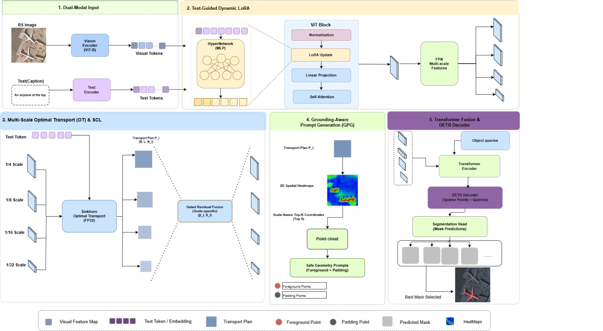
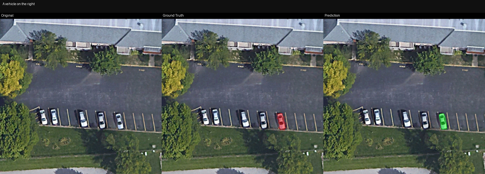
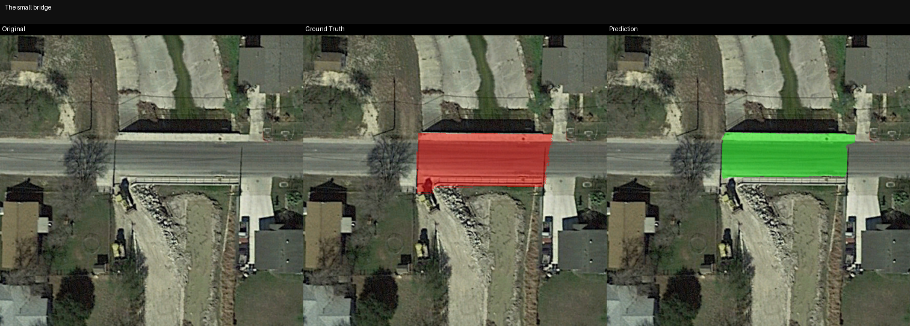
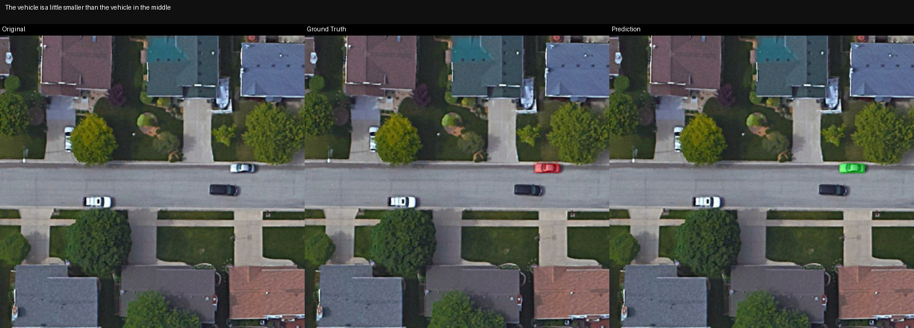
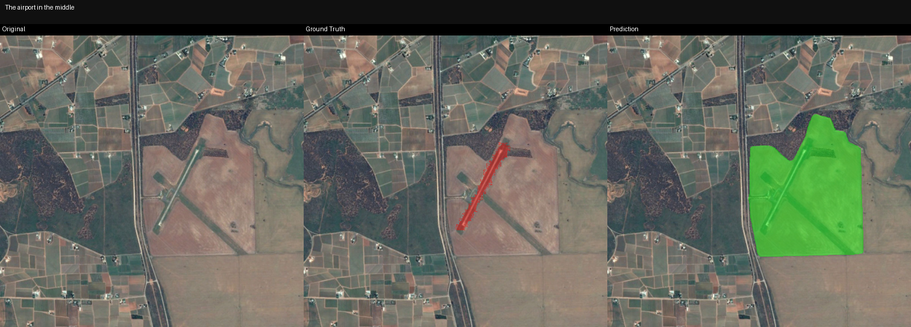
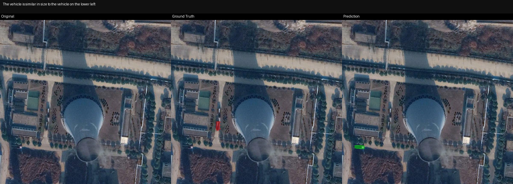
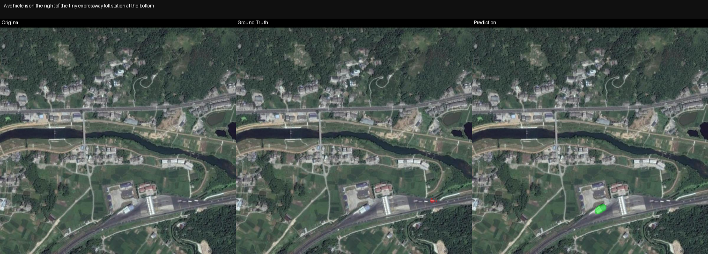

# Enhanced_RRSIS_OT: Enhanced Referring Remote Sensing Image Segmentation with Optimal Transport

**Enhanced_RRSIS_OT** extends **RRSIS_SAM3** with **4+1 novel techniques** for improved performance on referring remote sensing image segmentation, on RRSIS-D and RRSIS-HR.

---

## What's New (Over RRSIS_SAM3)

| Enhancement | Module | Description |
|-------------|--------|-------------|
| 🟢 **Text-Guided Dynamic LoRA** | [dynamic_lora.py](file:///d:/FYPPP/ahmadnoidea/lib/dynamic_lora.py) | Text-conditioned vision adapter weights — vision encoder adapts per-caption |
| 🟢 **Multi-Scale OT Alignment** | [multiscale_ot_alignment.py](file:///d:/FYPPP/ahmadnoidea/lib/multiscale_ot_alignment.py) | Scale-aware OT alignment across all FPN levels with gated residual fusion |
| 🟢 **OHEM + Focal + Boundary Loss** | [ohem_loss.py](file:///d:/FYPPP/ahmadnoidea/lib/ohem_loss.py) | Hard pixel mining + focal weighting + boundary-aware supervision |
| 🟢 **Contrastive Loss (InfoNCE)** | [contrastive_loss.py](file:///d:/FYPPP/ahmadnoidea/lib/contrastive_loss.py) | Auxiliary loss aligning masked visual features with text features |
| 🟢 **Grounding-Aware Prompt Generator** | [prompt_generator.py](file:///d:/FYPPP/ahmadnoidea/lib/prompt_generator.py) | Extracts point-based geometric prompts from OT transport plans |
| 🟢 **Scale-Aware Prompting (SAP)** | [prompt_generator.py](file:///d:/FYPPP/ahmadnoidea/lib/prompt_generator.py) | Dynamically adapts point counts based on object scale to suppress noise |

---

## Architecture



### Data Flow Summary

```
Image (B,3,504,504) + Caption (List[str])
  ├─ Step 0:   Normalize → [-1, 1]
  ├─ Step 1:   Text Encoder → language_features (seq, B, 256)
  ├─ Step 1.5: Dynamic LoRA → cache pooled text (B, 256) in all LoRA layers
  ├─ Step 1.8: ViT + LoRA → backbone_fpn: List[(B, 256, H_i, W_i)]
  ├─ Step 2:   Multi-Scale OT → aligned FPN + transport plan P (B, HW, seq)
  ├─ Step 3:   GPG + SAP → sparse points (B, K, 2)
  ├─ Step 4:   Encode Prompt → prompt tokens
  ├─ Step 5:   Transformer Encoder → fused hidden states
  ├─ Step 6:   DETR Decoder → N=3 mask hypotheses
  ├─ Step 7:   Segmentation Head → pred_masks (B, N, H, W)
  ├─ Step 8:   Best Mask Selection → (B, 1, 504, 504)  [IoU-based ranking]
  └─ Step 10:  Loss = SegLoss + 0.1 × Contrastive + 0.1 × SCL
```

---

## Key Differences from RRSIS_SAM3

| Feature | RRSIS_SAM3 | Enhanced_RRSIS_OT |
|---------|------------|---------------------|
| LoRA Type | Static (same weights for all inputs) | **Dynamic** (text-conditioned per-caption) |
| OT Alignment | Single-scale, one pass | **Multi-scale** across all FPN levels |
| OT Numerics | FP16 (NaN risk) | **FP32-safe Sinkhorn** with autocast disabled |
| Loss Function | Dice + BCE | **OHEM + FocalDice + Boundary + Contrastive + SCL** |
| Score Supervision | Uniform 1/N targets | **IoU-based query matching** (best query → 1.0, others → 0.0) |
| Contrastive Features | Pooled encoder output (no spatial info) | **FPN features** with real spatial structure |
| Vision-Language Bond | Fusion encoder only | **Early** (LoRA) + **Mid** (OT) + **Late** (Contrastive) alignment |
| Point Grounding | None | **GPG with Scale-Aware Prompting (SAP)** |

---

## Bug Fixes Applied (v2)

These critical bugs from v1 have been fixed in this release:

| Bug | Severity | Fix |
|-----|----------|-----|
| **Sinkhorn FP16 underflow** → NaN crash | 🔴 Critical | Force FP32 + `autocast(enabled=False)` inside Sinkhorn |
| **Score supervision** → all queries trained to 1/N | 🟠 High | IoU-based matching: best query → 1.0, others → 0.0 |
| **Contrastive loss** → constant spatial map | 🟡 Medium | Use real FPN features instead of pooled+expanded |
| **SCL weight** → hardcoded 0.1 | 🟢 Low | Configurable `scl_weight` parameter |
| **Deprecated APIs** → PyTorch warnings | 🟢 Low | Updated `torch.amp.GradScaler` and `torch.amp.autocast` |

---

## Supported Datasets

| Dataset | Train | Val | Test | Image Size | Categories | Reference |
|---------|-------|-----|------|------------|------------|-----------|
| **RRSIS-D** | 12,181 | 1,740 | 3,481 | 800×800 | 20 | DIOR-RSVG |
| **RRSIS-HR** | 2,118 | 268 | 264 | 1024×1024 | 7 | High-Res |
| **RefSegRS** | 2,172 | 413 | 1,817 | 512×512 | — | Original RS |

---

## Project Structure

```
Enhanced_RRSIS_OT/
├── sam3/                           # SAM3 core implementation
├── configs/
│   ├── enhanced_rrsis_uot.yaml     # Full configuration for enhanced model
│   └── rrsis_sam3.yaml             # Baseline configuration
├── data/
│   └── dataset.py                  # Dataloaders for RRSIS-D, RRSIS-HR, RefSegRS
├── refer/
│   └── refer.py                    # REFER API wrapper for dataset annotations
├── loss/
│   └── loss.py                     # Legacy loss functions (standard Dice + BCE)
├── lib/
│   ├── enhanced_model.py           # ★ Main model wrapper coordinating the enhancements
│   ├── dynamic_lora.py             # ★ Text-Guided Dynamic LoRA module
│   ├── contrastive_loss.py         # ★ InfoNCE Contrastive Loss module
│   ├── multiscale_ot_alignment.py  # ★ Multi-Scale OT Alignment with FP32-safe Sinkhorn
│   ├── ohem_loss.py                # ★ OHEM + Focal + Boundary Loss with IoU-based score ranking
│   ├── prompt_generator.py         # ★ GPG (Grounding-Aware Prompt Generator) + SAP
│   ├── decoder_ot_text.py          # ☆ OT-based text attention for decoder layers (Inactive/Experimental)
│   ├── rrsis_sam3_model.py         # Base model implementation (RRSIS_SAM3)
│   ├── rs_adapters.py              # Static LoRA adapter fallback
│   ├── ot_feature_alignment.py     # Single-scale OT fallback
│   └── ot_loss.py                  # Standard Dice+BCE loss fallback
├── args.py                         # CLI parameter definitions
├── train.py                        # Model training workflow
├── test.py                         # Model evaluation workflow
├── test_forward_pass.py            # Quick sanity test script to verify model forward pass
├── transforms.py                   # Target-aware augmentations and resize utilities
├── utils.py                        # Common training helper utilities
├── requirements.txt                # Project dependency packages
├── fine.sh                         # Optimized training shell script
└── test.sh                         # Evaluation shell script
```

---

## Training

### 🏆 Recommended Training Command (Best Performance)

Optimized hyperparameters for **RRSIS-D** (16GB+ VRAM):

```bash
env MPLBACKEND="agg" WANDB_MODE=disabled python train.py \
      --dataset rrsis_d \
      --data_root ./data/ \
      --sam3_ckpt ./pre-trained-weights/sam3.pt \
      --output_dir ./output/rrsis_d_enhanced_v2 \
      --image_size 504 \
      --lora_rank 16 \
      --lora_alpha 32.0 \
      --epochs 40 \
      --batch_size 2 \
      --grad_accum_steps 8 \
      --lr 5e-5 \
      --lr_backbone 1e-5 \
      --lr_decoder 5e-5 \
      --weight_decay 0.01 \
      --warmup_epochs 5 \
      --contrastive_weight 0.1 \
      --ohem_hard_ratio 0.3 \
      --ot_reg 0.1 \
      --ot_num_iter 10 \
      --num_ot_scales 3 \
      --boundary_loss_weight 0.5 \
      --focal_gamma 2.0 \
      --fp16 \
      --gradient_checkpointing \
      --seed 42 \
      --num_workers 4 \
      --use_dynamic_lora \
      --use_contrastive_loss \
      --use_multiscale_ot \
      --use_ohem_loss
```

Or run via the optimized launcher script:
```bash
bash fine.sh rrsis_d ./data ./pre-trained-weights/sam3.pt
```

### ⚡ Quick Training (Ablation / Dev Run)

```bash
env MPLBACKEND="agg" python train.py \
      --dataset rrsis_d \
      --data_root ./data/ \
      --sam3_ckpt ./pre-trained-weights/sam3.pt \
      --output_dir ./output/quick_run \
      --epochs 25 \
      --batch_size 2 \
      --grad_accum_steps 4 \
      --lr 5e-5 \
      --ohem_hard_ratio 0.25 \
      --fp16 \
      --gradient_checkpointing
```

### 🔬 Ablation Studies

Toggle individual enhancements using the override flags:

```bash
# Baseline (equivalent to RRSIS_SAM3):
python train.py --dataset rrsis_d --data_root ./data/ --sam3_ckpt ./pre-trained-weights/sam3.pt \
    --no_dynamic_lora --no_contrastive_loss --no_multiscale_ot --no_ohem_loss

# Only Dynamic LoRA:
python train.py --dataset rrsis_d --data_root ./data/ --sam3_ckpt ./pre-trained-weights/sam3.pt \
    --no_contrastive_loss --no_multiscale_ot --no_ohem_loss

# Only OHEM Loss:
python train.py --dataset rrsis_d --data_root ./data/ --sam3_ckpt ./pre-trained-weights/sam3.pt \
    --no_dynamic_lora --no_contrastive_loss --no_multiscale_ot
```

---

## Evaluation

### Full Evaluation on Test Set

```bash
python test.py \
      --dataset rrsis_d \
      --data_root ./data/ \
      --sam3_ckpt ./pre-trained-weights/sam3.pt \
      --split test \
      --resume ./output/rrsis_d_enhanced_v2/best_model.pth \
      --fp16
```

Or run via the evaluation script:
```bash
bash test.sh rrsis_d test ./output/rrsis_d_enhanced_uot/best_model.pth
```

### Evaluation with Visualization (saves predicted masks)

```bash
python test.py \
      --dataset rrsis_d \
      --split test \
      --resume ./output/best_model.pth \
      --visualize \
      --fp16
```

### Output of RRSIS_Pipeline 

| Dataset | mIoU | oIoU | P@0.5 | P@0.6 | P@0.7 | P@0.8 | P@0.9 |
| :--- | :---: | :---: | :---: | :---: | :---: | :---: | :---: |
| **RRSIS-D (test)** | 70.51% | 80.24% | 82.36% | 77.10% | 66.82% | 50.59% | 31.08% |
| **RRSIS-HR (test)** | 53.64% | 58.64% | 66.67% | 62.50% | 59.09% | 48.86% | 18.18% |


---

## Qualitative Predictions & Failure Cases

We present a qualitative analysis of the proposed DyMS-OT framework evaluated on the test split of the datasets. Below are representative examples of successful predictions (best cases) and failure cases.

### Successful Predictions (Best Cases)

* **A vehicle on the right** (TEST Sample `16_0`, IoU = 98.34%): Sharp object boundaries cleanly separated from background clutter and shadows.
  
* **The small bridge** (TEST Sample `34_0`, IoU = 95.35%): Fine-grained details and contours of small objects are perfectly preserved.
  
* **The vehicle is a little smaller than the vehicle in the middle** (TEST Sample `10_0`, IoU = 68.65%): Accurately parsed comparative spatial references.
  

### Failure Cases (IoU = 0.00%)

* **The airport in the middle** (TEST Sample `4_0`): Shares color/texture characteristics with surrounding clutter, leading to false positives on adjacent runways.
  
* **The vehicle is similar in size to the vehicle on the lower left** (TEST Sample `47_0`): Fails to resolve relative comparisons without an absolute spatial or visual anchor.
  
* **A vehicle is on the right of the tiny expressway toll station at the bottom** (TEST Sample `14_0`): Tiny targets (<20 pixels) are lost during deep spatial downsampling under complex referencing clauses.
  

---

## All CLI Arguments Reference

| Category | Argument | Default | Type | Description |
|----------|----------|---------|------|-------------|
| **Paths** | `--data_root` | `./data/` | str | Root directory of datasets |
| | `--output_dir` | `./output/` | str | Output directory for checkpoints |
| | `--sam3_ckpt` | `./pre-trained-weights/sam3.pt` | str | SAM3 pretrained checkpoint |
| | `--resume` | `` | str | Resume from checkpoint |
| **Dataset** | `--dataset` | `refcoco` | str | Dataset: `rrsis_d`, `rrsis_hr`, `refsegrs` |
| | `--split` | `train` | str | Data split |
| | `--max_tokens` | `32` | int | Max text token length |
| **Model** | `--image_size` | `504` | int | Input size (divisible by 14) |
| | `--lora_rank` | `16` | int | LoRA rank |
| | `--lora_alpha` | `32.0` | float | LoRA alpha scaling |
| **Enhancements** | `--use_dynamic_lora` | `True` | flag | Enable Dynamic LoRA |
| | `--use_contrastive_loss` | `True` | flag | Enable InfoNCE loss |
| | `--use_multiscale_ot` | `True` | flag | Enable Multi-Scale OT |
| | `--use_ohem_loss` | `True` | flag | Enable OHEM loss |
| | `--no_dynamic_lora` | `False` | flag | Disable Dynamic LoRA |
| | `--no_contrastive_loss` | `False` | flag | Disable contrastive loss |
| | `--no_multiscale_ot` | `False` | flag | Disable multi-scale OT |
| | `--no_ohem_loss` | `False` | flag | Disable OHEM loss |
| **Enhancement Params** | `--contrastive_weight` | `0.1` | float | InfoNCE loss weight |
| | `--ohem_hard_ratio` | `0.3` | float | OHEM hard pixel fraction |
| | `--ot_reg` | `0.1` | float | Sinkhorn regularization |
| | `--ot_num_iter` | `10` | int | Sinkhorn iterations |
| | `--num_ot_scales` | `3` | int | FPN scales for OT |
| | `--boundary_loss_weight` | `0.5` | float | Boundary loss weight |
| | `--focal_gamma` | `2.0` | float | Focal loss gamma |
| **Training** | `--epochs` | `40` | int | Training epochs |
| | `--batch_size` | `2` | int | Batch size per GPU |
| | `--lr` | `5e-5` | float | Base learning rate |
| | `--lr_backbone` | `1e-5` | float | Backbone (LoRA) LR |
| | `--lr_decoder` | `5e-5` | float | Decoder/seg head LR |
| | `--weight_decay` | `1e-2` | float | AdamW weight decay |
| | `--warmup_epochs` | `5` | int | LR warmup epochs |
| | `--grad_accum_steps` | `4` | int | Gradient accumulation |
| **Optimization** | `--fp16` | `True` | flag | Mixed precision (FP16) |
| | `--gradient_checkpointing` | `True` | flag | Gradient checkpointing |
| | `--seed` | `42` | int | Random seed |
| **Evaluation** | `--eval_only` | `False` | flag | Evaluation mode only |
| | `--visualize` | `False` | flag | Save prediction visualizations |

---

## Citation

```bibtex
@article{enhanced_rrsis_ot_2026,
    title={Enhanced RRSIS-OT: Enhanced Referring Remote Sensing Image Segmentation with Optimal Transport},
    year={2026}
}
```
