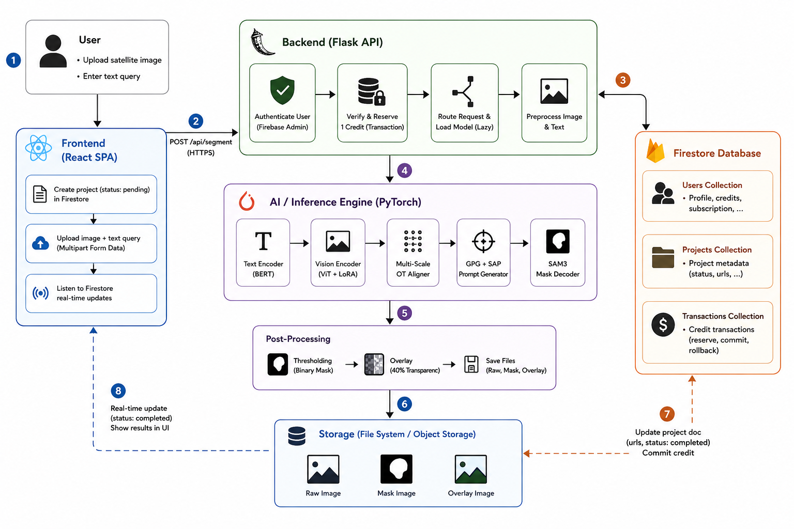

# GeoSegAI — AI-Powered Referring Remote Sensing Image Segmentation

GeoSegAI is a state-of-the-art web application designed for Referring Remote Sensing Image Segmentation (RRSIS). It enables researchers, GIS professionals, and data analysts to upload high-resolution satellite or aerial imagery and extract precise target objects (such as airports, stadiums, harbors, golf fields, and vehicles) using natural language English queries.

The platform coordinates a multi-model architecture, integrating:
1. **CADFormer**: A context-aware decoding transformer optimized for fine-grained visual-textual fusion.
2. **RS-OT-SAM3**: An advanced model utilizing Unbalanced Optimal Transport (UOT) coupled with a Segment Anything 3 (SAM3) backbone for high-precision boundary segmentation.

---
## 🏛️ System Architecture



The system features complete end-to-end integration:
* **Frontend**: React + TailwindCSS + Vite + Firebase Client SDK.
* **Backend**: Flask API executing local PyTorch inference pipelines on CPU or CUDA-accelerated hardware.
* **Core Models**: CADFormer (visual-textual fusion) and RS-OT-SAM3 (Optimal Transport boundaries + Segment Anything 3).
* **Database & Auth**: Google Firebase (Authentication & Firestore NoSQL) for secure user sessions, credit reservation, and project management.

---

## Demo

[Watch the RRSIS-OT Web App Demo Video](RRSIS_Web_Demo.mp4)

---

## 📂 Project Directory Structure

```
GeoSegAI/
├── backend/                  # Flask REST API Backend
│   ├── app.py                # Main server entry point & Firestore auto-sync
│   ├── config.py             # Flask environment configurations
│   ├── models/               # Centralized model SOURCE CODE (Tracked in Git)
│   │   ├── __init__.py       # Package initializer
│   │   ├── cadformer/        # CADFormer network modules (LAVT & BERT code)
│   │   │   ├── lib/          # LAVT network modules
│   │   │   └── bert/         # BERT network modules
│   │   └── rsotsam3/         # RS-OT-SAM3 network modules
│   │       ├── sam3/         # SAM3 package
│   │       └── lib/          # UOT & LoRA alignment code
│   ├── weights/              # Centralized binary WEIGHTS (Excluded from Git / Large Assets)
│   │   ├── cadformer/        # CADFormer weight checkpoints
│   │   │   ├── bert/         # Local BERT tokenizer weights/config
│   │   │   ├── model_best_RMSIN.pth  # Fine-tuned CADFormer checkpoint (2.8 GB)
│   │   │   └── swin_base_patch4_window12_384_22k.pth  # Swin Backbone (450 MB)
│   │   └── RS-OT-SAM3/       # RS-OT-SAM3 weight checkpoints
│   │       ├── sam3.pt       # Base SAM3 checkpoint (3.4 GB)
│   │       └── best_model.pth # Fine-tuned checkpoint (3.7 GB)
│   ├── data/                 # Static data configurations & mock assets
│   ├── routes/               # API route blueprints (admin, payments, segmentation)
│   ├── services/             # Core backend business logic (Auth, Model Registry, Credits)
│   └── uploads/              # Local storage folder for uploaded imagery
├── docs/                     # User documentation and workflow pipelines
├── public/                   # Frontend static assets (icons, images)
├── src/                      # React Client Source Code
│   ├── components/           # Reusable UI widgets & modal templates
│   ├── context/              # React Context Providers (Auth, Admin State)
│   ├── firebase/             # Firestore SDK queries & database configurations
│   ├── layouts/              # UI wrappers & Sidebar structures
│   └── pages/                # Screen views (Dashboards, Results, Model Admin)
├── firestore.rules           # Database access control rules
├── package.json              # Frontend node dependencies
├── tailwind.config.js        # UI style tokens & theme configurations
└── vite.config.js            # Vite compiler configuration
```

---

## 🚀 Setup & Installation

### 1. Prerequisites
* **Node.js**: v18 or newer
* **Python**: v3.10 to v3.12
* **Git**: For version tracking

---

### 2. Backend Installation (Python Flask)

1. Navigate to the backend directory:
   ```bash
   cd backend
   ```

2. Create a virtual environment and activate it:
   ```bash
   python -m venv .venv
   # Windows:
   .venv\Scripts\activate
   # Linux/WSL/macOS:
   source .venv/bin/activate
   ```

3. Install required PyTorch dependencies:
   * **For GPU Support (CUDA 12.1)**:
     ```bash
     pip install torch torchvision --index-url https://download.pytorch.org/whl/cu121
     ```
   * **For CPU-Only Execution**:
     ```bash
     pip install torch torchvision
     ```

4. Install the remaining dependencies:
   ```bash
   pip install -r requirements.txt
   ```

5. **Place Model Weights**:
   Create the weights directories and place your model checkpoints (since large binary files are excluded from Git):
   * Create `backend/weights/cadformer/` and place the following files there:
     - `model_best_RMSIN.pth` (2.8 GB fine-tuned CADFormer checkpoint)
     - `swin_base_patch4_window12_384_22k.pth` (450 MB Swin Backbone checkpoint)
   * Create `backend/weights/RS-OT-SAM3/` and place the following files there:
     - `sam3.pt` (3.4 GB base SAM3 checkpoint)
     - `best_model.pth` (3.7 GB fine-tuned checkpoint)
   *(Note: Local BERT tokenizer configurations inside `backend/weights/cadformer/bert/` are already tracked in Git).*

6. Ensure your firebase credentials (`serviceAccountKey.json`) are placed inside the `backend/` root directory to authenticate transactions.

7. Run the Flask server:
   ```bash
   python app.py
   ```
   The backend server will verify model state connections and run on `http://localhost:5000`.

---

### 3. Frontend Installation (React Vite)

1. Navigate back to the project root directory:
   ```bash
   cd ..
   ```

2. Install the Node packages:
   ```bash
   npm install
   ```

3. Launch the development server:
   ```bash
   npm run dev -- --port 5173
   ```
   Open `http://localhost:5173` in your browser.

---

## 🧠 Model Registry and Dynamic Auto-Sync

To maintain a professional coding workflow, models are **code-driven**. To add or update a model:
1. Open the model registry in `backend/services/model_registry.py`.
2. Add or edit a model definition inside the `MODEL_REGISTRY` dictionary.
3. On application startup, the backend automatically performs a database sync:
   - Registers new models in Firestore.
   - Syncs display names, versions, and description changes.
   - Automatically marks any database entries that do not have active backend python files with `isIntegrated: false`.
4. User and Admin Dashboards will automatically read these values and update model counters, validation guards, and dropdown select elements dynamically.
